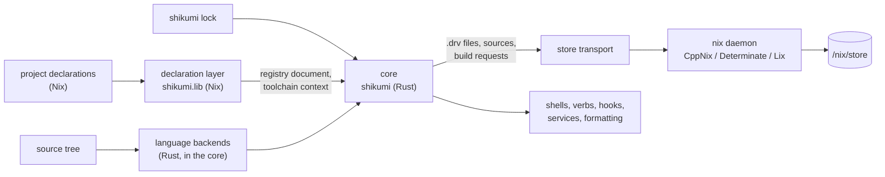
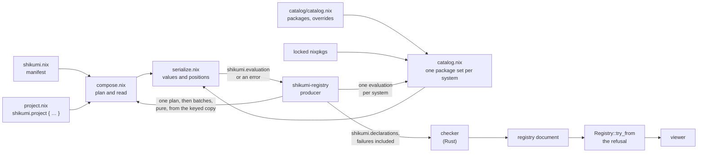

# Shikumi architecture

This page says how Shikumi is put together: who owns what, how a build and a shell entry flow, and
which invariants hold. [The capability page](../reference/capabilities.md) says what Shikumi provides.

Everything here is an accepted target unless it says it's current, and the sections marked **open**
are mechanisms still being chosen, each with what decides it. Four parts are current: the
repository's foundation (the gate, its checks in `tools/repo-check/`, and
[the benchmark harness](#the-benchmark-harness)); the base the core builds on (the path computation
of [derivation synthesis](#derivation-synthesis), both implementations of
[the store transport](#store-transport), and the re-addressing and rooting that
[early cutoff](#early-cutoff) and [roots](#caches-and-roots) rest on);
[the declaration layer](#the-declaration-layer)'s composition, catalog, checker, registry document
and toolchain context; and [the context cache](#context-cache) and [the lock](#lock) they're
evaluated through.

## Shape

Target structure:

There are two halves. The **declaration layer** is Nix and is small: it turns project declarations
into the registry document and a toolchain context. The **core** is one Rust binary, `shikumi`, and
does everything that scales with the size of the repository: unit discovery, `.drv` synthesis,
scheduling, early cutoff, caching, and the environment features.

Shikumi doesn't own the Nix daemon, the store, the evaluator or the compilers. It talks to the
daemon, runs the host's evaluator, and drives unmodified compilers.

## The declaration layer

The declaration layer turns a repository's project declarations into the registry document, which
the core reads, and into the toolchain context and shell environments. Its Nix half, `shikumi.lib` in
`nix/declarations/`, reads and serializes; its Rust half, the checker in `crates/registry/`, judges.
Composition, the catalog's reading of the locked nixpkgs, serialization, the checker, the module
adapter, the registry document and the toolchain context are current. Shell environments are a
target.

- **Owners.** `factory.nix` owns `shikumi.project`, which marks a plain record as a declaration and
  changes nothing else. `vocabulary.nix` owns `shikumi.lib.types`, whose constructors only build
  data. `serialize.nix` owns turning any value into a tagged tree with source positions.
  `compose.nix` owns the manifest and which declaration and catalog files a composition reads.
  `catalog.nix` owns the one package set: importing the locked nixpkgs for a system with the
  catalog's overlay, what evaluation can see of each package the catalog names, and the toolchain
  context. `layer.nix` wires the layer together once, for `default.nix`, which hands `shikumi.lib`
  to whoever imports the layer, and for `produce.nix`, which alone asks for the toolchain context.
  `call.nix` owns
  calling a file with the arguments it names. `forced.nix` owns the frame around every first forcing
  of a user's value. `produce.nix` owns the requests the
  producer can make and the frame that names a project in the evaluator's trace. `modules.nix` owns
  the module adapter. In the `shikumi-registry` crate, `check.rs` owns every judgement about a
  declaration and the catalog, `vocabulary.rs` owns what each type accepts and the one definition of
  each shape: the declaration record, the manifest's fields, the catalog's record and the field
  names they share. `document.rs` owns the document's types, which are those records' serde shape
  with their descriptions, its schema and the refusal, and the one definition of a shell's sources
  and of who claims a name, which the checker reads too. `layer.rs` owns what both halves name: each
  file the layer reads, the arguments it's offered, the fields read by name and the frames in a
  trace, written to `layer.json`, which the layer's Nix reads. `render.rs` owns the text form of
  findings, `failure.rs` owns reading an evaluator's error, the one place an evaluator's text is
  parsed, `evaluation.rs` owns the contract of each evaluation's answer, `produce/` owns the
  producer, which projects a composition holds and how they're evaluated, and the one function that
  builds every evaluation's command line, `context/` owns [the context cache](#context-cache),
  `toolchain.rs` owns the toolchain context's contract, and `view.rs` owns the viewer. The
  `shikumi-lock` crate owns [the lock](#lock), and the `shikumi-contract` crate the machinery every
  contract is written with: its name and version fields, checked strings, closed sets of names and
  the canonical JSON rendering. The `shikumi` crate in `crates/cli/` only parses arguments and lists
  subcommands.
- **Entry point.** `shikumi.lib` takes the nixpkgs source tree from whoever imports it.
  `shikumi.lib.compose { root; manifest; }` is pure: it gives the serialized manifest, each listed
  project's declaration file, the catalog's file and systems, and `read`, which serializes one
  project from its file without reading the manifest again, so a caller can evaluate each project
  apart. `shikumi.lib.catalog root { file; system; }` reads the catalog for one system. nix-unit
  tests call both directly, with no CLI.
- **One scope for everything a declaration reaches.** `scope.nix` owns what every user file is
  evaluated with: each declaration, manifest and catalog file, every file one of them imports, and
  nixpkgs, whose `lib` and package set a user file is handed and whose own importers take a user's
  path. Its `builtins` lacks those the layer table withholds: every builtin that reaches a fetcher,
  `getFlake`, `fetchTree`, `fetchGit`, `fetchTarball`, `fetchurl`, `fetchMercurial` and
  `fetchClosure`, whatever pure and restricted mode would make of a call, since Determinate Nix
  lets `getFlake` read any flake, commit or directory on the machine. Its `findFile`, which nixpkgs
  needs for `<nix/fetchurl.nix>`, refuses a lookup-path entry that names a scheme, which reaches
  the same fetchers; `<...>` and a declaration's own `__nixPath` go through it. Its `import`,
  `scopedImport` and `builtins` keep a file they reach in the scope, and the global names an
  evaluator gives a withheld builtin are shadowed, since a scope can add names but not take them
  away. `scopedImport` evaluates a file again on every import, and nixpkgs
  imports many of its files more than once, so a file under nixpkgs or the repository's copy goes
  through a lazy mirror of its tree, one `readDir` per directory and one value per file, which keeps
  what the evaluator's own import cache would: on a nixpkgs evaluation it costs a few percent, where
  a scope without it costs half again as much time and memory.
- **Plain records, no module system.** `shikumi.project` takes a plain attribute set, a flat set of
  small records, and returns it marked as a declaration and otherwise unchanged, so the source
  position of every attribute survives to serialization. There's no fixpoint, no merge order and no
  priority: what a user writes is what Shikumi reads.
  Splitting a declaration is plain `import` and `//`. Composition across projects is the manifest,
  so Shikumi needs no aspects system of its own. This follows
  [the Nix style guide](../reference/nix-style.md#the-module-system): a library's own settings are
  plain schemas, and a module system reaches them through a thin adapter at the edge.
- **Checking happens in Rust.** The Nix side serializes and never decides: every value goes to the
  checker as written, tagged with what kind of value it was and with the position of every
  attribute, so a mistake Nix can still represent becomes a finding rather than an evaluation error
  that would hide the others. Only what Nix can't get past, such as a syntax error or a `throw`,
  stops a declaration's evaluation, and then only that project's. The checker checks each
  declaration against the declaration record and the repository's extension schemas, then applies
  the rules across projects, and collects every finding with a stable code, the field's path and its
  location.
- **The vocabulary is data.** `shikumi.lib.types` builds tagged attribute sets that serialize like
  any value, so a repository's extension schema reaches the checker the same way its declarations
  do. The checker reads it into the same type model its own declaration record is written in, and
  accepts only the public kinds, so a repository can't name the type for a command line, which skips
  the checks that keep a string out of the document. The reference page is generated from that
  model. The trade-off is that no option types are declared to a module system, so an editor can't
  complete a declaration from them; emitting an editor schema from the vocabulary is a target.
- **Positions.** `builtins.unsafeGetAttrPos` gives the start of the attribute path that defined each
  attribute, the same on CppNix, Determinate Nix and Lix, and serialization makes its file relative
  to the repository root, so the document stays identical across worktrees. Where the evaluator has
  no position inside the repository, as for list elements, attributes `builtins.mapAttrs` built and
  attributes nixpkgs' `genAttrs` built, a finding is located at the nearest enclosing field.
- **The diagnostic model.** A finding has a stable code, a structured path, a location the checker
  supplies, an optional fix, and related locations, such as the first declaration of a duplicated
  name. Findings are collected, never thrown, carried in the document as JSON and rendered as text
  the way rustc renders errors: the code and the sentence, the file, line and column, the user's line
  with the field underlined, and the fix.
- **The module adapter.** For a consumer that is a module system, NixOS, Home Manager or
  flake-parts, `shikumi.lib.modules` declares `shikumi.projects` with an option type that takes one
  `shikumi.project` result per name and hands back the same value. It has no merging and no schema;
  a second definition is the module system's error, not a merge.
- **One refusal.** The checker decides what's wrong; the document carries it.
  `Registry::try_from` is the only way the Rust side gets a registry, and it refuses a document with
  a diagnostic, an unknown field or another version. Every Rust entry point goes through it, so each
  refuses the same declarations.
- **Producing.** The producer evaluates through [the context cache](#context-cache), in three
  parts, each under its own key: the plan, the catalog for each system, and the projects. A part
  the cache holds isn't evaluated. For a part that misses, the producer copies its keyed files into
  a private store and runs the host's `nix-instantiate` on `produce.nix` in pure mode: once to plan
  the composition, which reads the manifest, names each project's declaration file and reads no
  declaration, then the projects in batches, at least four for each core the process may use and
  none of more than 64 projects, as many at once as it has cores. Each answer is read through its
  schema on Rayon's pool as it arrives, and the assembled declarations go to the checker. One
  function builds every evaluation's command line: pure and restricted evaluation; the private
  store as the store evaluation reads and `dummy://` as the one it would build in;
  import-from-derivation, `builtins.exec`, plugins and experimental features off; `nix-path` empty;
  no configuration file; every frame of the trace in the plain format; no environment beyond the
  evaluator's own cache and temporary directories, and `/` as the working directory. So a
  declaration reads its keyed files, the locked nixpkgs and nothing else, and every read of a build
  output fails, since the `.drv` it would come from isn't in the store evaluation reads. It needs no
  daemon and no experimental feature on any implementation.
- **Isolation.** A batch that fails names its project in the trace, by the frame `produce.nix` puts
  around every evaluation of a declaration. That project gets the failure, and the projects before
  and after it are evaluated again, without it, in batches of their own. A failure no frame names,
  such as an evaluator that's killed, halves its batch until it's down to one project. Evaluation is
  pure and a failed evaluator leaves nothing behind, so every project comes out as it would
  evaluated alone. A focused composition is evaluated the same way, in rounds: the focused project,
  then the listed projects its serialized `dependsOn` and toolchain imports name, and so on, so a
  failed dependency is that project's finding and the focused project is still checked, each as the
  global composition gives it. The catalog's evaluations reach no declaration, so a failure in one
  is the catalog's wherever its frames lie. The evaluator processes belong to the run: each is
  started and reaped by one of the run's scoped threads, no evaluation starts after an error, and
  Ctrl-C reaches them through the terminal's process group. A `shikumi` killed any other way leaves
  its running evaluators to finish their batch, at most 64 declarations, or their package set, and
  exit, or, for a declaration that never terminates, to run until they're killed too. Tying each
  evaluator to its parent's death would take a hook run between fork and exec, which makes the
  standard library fork the whole process rather than spawn the child: at 10000 projects that cost
  2.4 s of CPU and 0.6 s of wall time per run.
- **The catalog.** The repository's catalog is the one place its packages come from, and neither it
  nor any declaration touches a package set: the catalog names each package by its attribute path in
  the locked nixpkgs, and a project picks packages by catalog name. So a package that differs from
  nixpkgs' comes only from the catalog's overlay, where each entry carries its reason and release,
  and a batch of declarations evaluates no nixpkgs and costs what it does without a catalog. The catalog's directory and systems are the
  manifest's to say, so the system never comes from the host, and the plan names the catalog's file.
  The producer then evaluates the catalog once for each system, as evaluations of their own at the
  front of the first round's queue, beside the projects' batches. Each imports the locked nixpkgs for
  that system with the catalog's `overrides` as its one overlay and an explicit empty `config`, so
  no configuration or overlay of the host's is read, and the evaluator's empty environment keeps
  nixpkgs' `NIXPKGS_ALLOW_*` variables out too. It resolves each entry's path there, and a path that
  names nothing, or a package that throws as it's read, resolves to no package rather than failing
  the catalog. It answers three things: the catalog's value, serialized like a declaration; which
  package each catalog name resolves to, by the package's `name`; and,
  for every package reachable from them through the propagation attributes, its `pname`, version,
  `meta.mainProgram` and what it propagates. No `outPath` or `drvPath` is forced, so nothing is
  instantiated or built and the answer carries no store path. A catalog that fails to evaluate is
  one finding at the catalog's file, and the checker checks nothing against it.
- **Toolchains and shells.** A toolchain is defined under one project's `toolchains`, and another
  project imports it under `project.imports`, naming the project that defines it. The import names
  its owner so a focused composition can take that project with it from the declaration it has
  already read, the way it takes a dependency, without reading the others to find who defines it.
  The checker forms each shell's sources, a project or one of its toolchains, in one order: every
  toolchain, by its project's name and then its own, then every project by name. That's every
  source for the global composition, and the focused project, its toolchains and the ones it imports
  for a focused one. The order is the same either way, so a rule that keeps the first of two
  definitions keeps the same one and a focused composition reports a clash where the global one
  does; and since a toolchain is shared by every project that uses it, a clash between the two lands
  on the project. On that list the checker holds each variable to one definition, with no
  precedence between a project's and a toolchain's and `PATH` reserved to the shell, and walks each
  system's propagation graph breadth first from every pick, keeping the first package under each
  name, a `pname` or a `mainProgram` alike, and refusing a different one.
- **Toolchain context.** The store paths a backend or a shell needs from the catalog: each catalog
  entry's package, for each system the manifest names, as the store path of its output, through the
  same `pkgs` and overlay the catalog's read uses. It's the one step that forces a package's
  `outPath`, which computes the derivation's paths without writing the `.drv`, building it or
  reading anything a build writes, since evaluation runs read-only. A package nixpkgs refuses to
  evaluate, for its licence or a known vulnerability, has no path. It's evaluated apart from the
  catalog's read, so such a package can't fail the read, and it's never part of the registry
  document. [The context cache](#context-cache) keeps it per system, keyed by the catalog's
  directory. It's the `shikumi.toolchain-context` record, version 1, unpublished while what its
  readers need, compiler, linker and builder paths, base environment and flags, is settled.
- **No builds during evaluation.** Nothing in the layer builds or reads a derivation output, and a
  declaration that reads one through the evaluator is refused, with or without its string context.
- **Cost.** Composition and checking are linear in the size of the declarations. Global composition
  imports and serializes each declaration once, one visit per value and one position lookup per
  attribute, after counting each top-level field up to a budget of 100000 values and 32 levels, so a
  value that refers to itself or shares one value many times becomes a finding at that field rather
  than an endless walk. The checker visits each serialized value once. Across projects it sorts the
  manifest's directories once for overlaps, walks the dependency graph and each project's step graph
  once for loops, and keeps one map per name space for duplicates. Each project is checked on its
  own on Rayon's pool, and the findings keep name order. The rules on a shell are linear too: one
  lookup per package picked against the catalog's names, one map entry per variable, one map entry
  per toolchain, and, per system, one visit to each package reachable from the picks, since a
  package reached again is the same package. Reading the catalog is one evaluation of the pinned
  nixpkgs per system per run, whatever the number of projects or batches, and grows with the
  packages the catalog names and what they propagate. A focused composition reads only its
  project's closure through dependencies and imports. Isolation keeps the evaluation linear, since a batch reads its
  declaration files without the manifest and holds at most 64 projects. A failure a frame places in
  its project costs at most one batch and two evaluator starts of about twenty milliseconds: a
  project that evaluated is evaluated at most twice, once in the batch that failed after it and once
  in the batch of those before the failure. A failure no frame places halves its batch down to its
  project, so it costs about two batches and thirteen starts, and a project beside it is evaluated
  up to seven times. Nothing per compile unit goes through Nix.
- **Failure.** A finding is data, and the producer exits with every finding. A declaration that
  fails to evaluate is a finding too. `failure.rs` reads the evaluator's error under `--show-trace`,
  which CppNix, Determinate Nix and Lix print in one shape: it names the kind from the evaluator's
  message, and from the frame a `throw` adds before reading a message the user wrote, so a thrown
  message can't pass for another kind. It splits the frames by file into the user's, Shikumi's and
  everyone else's, such as nixpkgs' `lib`. The finding sits at the innermost frame in the user's
  files, with the user's other frames as notes, or at the project's file where the evaluator gives
  no position there, and the rest are hidden. The layer forces every value a user wrote inside a
  frame of its own, so a failure inside that frame is the user's even where the evaluator places it
  in Shikumi's code or nowhere. A failure is a Shikumi bug only when it never passed through the
  user's files and Shikumi's own code ran where it happened, outside every such frame or called from
  inside one; it's reported with Shikumi's frames for the report. Text that isn't valid UTF-8 fails
  only as it's written out, so its project is evaluated once more with each string written under a
  frame that names its field. A message `failure.rs` doesn't recognize keeps its kind unrecognized
  and the evaluator's words. A manifest that fails to evaluate is the one finding, since it says
  where every project is.

## The core

One process per command. One Tokio runtime per process. CPU work such as hashing and scanning runs on
a bounded blocking pool and never on the runtime's workers. Every task belongs to the command that
started it and is cancelled with it; Ctrl-C stops outstanding builds through the transport before the
process exits.

### Context cache

Current. The producer keeps what each part of a composition evaluated to, and the toolchain
context, under a key that covers everything the evaluation could read and everything that changes
how it evaluates. A hit skips the evaluator.

- **The evaluation reads only what the key hashed.** The keyed file set derives from `layer.rs`: the
  manifest, every tracked file named as a declaration or catalog file, and every tracked `.nix` file
  inside a listed project's directory or the catalog's. A file Git doesn't track, a symlink and
  anything behind one are left out. Each part is staged in a directory holding exactly its keyed
  files, as they were hashed, and a marker file whose value is the copy's root as a path, then
  put in a private store under Shikumi's cache directory, which holds only such copies, the
  layer and the locked nixpkgs. Each evaluation opens that store under a database of its own,
  loaded with `nix-store --load-db` and registering only its own copies, the layer and the locked
  nixpkgs, so every other path in the store is invalid to it. The evaluator enters each copy by
  `builtins.path` with the NAR hash the producer computed, which pure mode allows without reading
  anything else; naming another path the store holds is refused as it would be on an empty store.
  A read of anything the copy doesn't hold is a `not-keyed` finding naming the file, and a read pure mode refuses, of a
  file outside the repository, the clock, the host's system, the search path or a URL, is an
  `impure` finding.
- **The key** covers the evaluator's resolved program path and its size, mtime and inode, which name
  its implementation, version and build; every setting the producer pins, from the one table its
  command line is built from; the layer's and the locked nixpkgs' NAR hashes; each keyed file's
  path, digest and executable bit; and the request. The evaluator reads no configuration file:
  `NIX_CONF_DIR` names an empty directory and `NIX_USER_CONF_FILES` is empty, so the command line is
  all it's told. The host's system can't change a result, since pure mode takes
  `builtins.currentSystem` away and the manifest names every system the catalog is read for, and
  neither can the checkout's location, since a declaration sees only the copy.
- **Parts.** The plan's part is the manifest and every tracked file named as a declaration or
  catalog file, which is what it tests for; the catalog's is its directory; the projects' is the
  manifest and every project's and the catalog's directory. Editing a declaration misses the plan
  and the projects and keeps the catalog's read, the slowest evaluation of a run.
- **Cheap hits.** A stat cache per checkout keeps each keyed file's size, mtime, ctime, inode, device
  and mode beside its digest, so a run rehashes only files whose stat changed. As in Git's index, an
  entry whose mtime or ctime isn't strictly older than the stat cache's own file is racily clean and
  is hashed again, so an edit made in the tick the cache was written can't hide behind an unchanged
  stat. A hit costs one `git ls-files`, a stat per keyed file and a read of each part's entry;
  finding the keyed files is a lookup of each tracked `.nix` file's ancestors among the keyed
  directories, linear in the tracked files and their depth.
- **Where it lives.** Under `$XDG_CACHE_HOME/shikumi`, or `~/.cache/shikumi`, never in the checkout.
  Entries are keyed by content, so worktrees of one commit share them; a stat cache is one per
  checkout; a private store is one per evaluator, since each implementation keeps its own store
  database. Entries are bounded at 512 MiB and stat caches at 256, least recently read first. A
  store's keyed copies are collected once more than 8 have gathered, so each collection removes a
  few and no one run pays for many: a collection costs about a tenth of a second per thousand files
  the copies it deletes hold.
- **How runs share the cache.** A hit reads entries and waits on nothing. A miss holds the store's
  collection lock shared from before its first root until every copy it needs has landed. Each
  copy is rooted by a link of its own in the store's roots, but the link names a path that isn't
  valid until its copy lands, and a collection skips such a root; the copying evaluation's own
  temporary root ends when it exits. A collection holds that lock alone from before it reads the
  roots until it has deleted, so under the hold it either ends before the roots or starts after
  the copies, and finds every root valid. Every implementation takes the lock with `flock`, and a
  copying evaluation asks for a shared hold without waiting to write its temporary root, so a copy
  made under the hold proceeds and only a collection waits. A miss waits only for a collection
  already running.
- **When a collection starts.** Maintenance starts a collection only when it finds the lock free,
  so it doesn't queue a collection behind copies already in flight. It can't hand that lock to the
  collection, though, so a run whose shared hold comes in the moment between the test and the
  collection taking the lock makes the collection, and the end of the run that started it, wait
  for that run's copies.
- **Runs adding the same path take turns,** under one of a fixed set of locks taken in order. Lix
  checks a path's validity again after its own lock through its path-info cache, which keeps a
  negative answer for as long as `narinfo-cache-negative-ttl` once the process has looked the path
  up and missed, so two adds at once could each write the path, the second deleting the tree the
  first is reading.
- **What a run leaves.** Staging directories, evaluation databases, roots and every file written
  to be renamed into place are named for the process that made them, and maintenance removes those
  whose process is gone. A store no run has used for 30 days goes with its pins, its state and its
  twin, and a store with no mark yet, one another run has only just made, is kept.
- **Keyed copies are placed, not copied.** The staged tree of a part is its copy, already hashed
  from the bytes staging read. The producer makes it read-only with Nix's canonical mtime, renames
  it into the store, each part on Rayon's pool, and loads every registration into the store's
  database at once with `nix-store --load-db`, as each evaluation's own database is loaded. An
  evaluator copying it would read, hash and write every file again on one core while the miss
  waits. A path counts as there only when the store's database holds it as valid, since a valid
  path is never hashed again: a tree on disk at a path the database doesn't hold, which an
  interrupted collection or a cleaned database leaves, is deleted and the copy placed, as Nix's own
  add does. The layer and the locked nixpkgs are copied by an evaluation, which finds them already
  there after a store's first run.
- **Where the store's state lives.** Its database, roots and collection lock are under its own
  `nix/var/nix`, unless that would put the socket a copy hands its temporary root to past 104
  bytes, the most a socket address holds on macOS (108 on Linux): Lix 2.95 reaches a longer one
  through a helper whose failure it doesn't retry, so a copy that starts while a collection gets
  ready would fail; Lix 2.96 retries it. Then the state lives in a real directory of its own in the
  temporary directory, which only this user can write, recorded in the store and made again when
  the record names no such directory; when the temporary directory is cleaned, the next run starts
  on an empty database and copies again what it needs. The directory names its store and the
  process that made it, and goes with its store: a run that replaces it removes it, maintenance that
  forgets a store removes its state, and maintenance removes any such directory its store doesn't
  record once the process that made it is gone, which takes the state of a cache removed by hand.
- **The store's twin, for Lix.** Lix reads a `local?root=` store at its real location, so a
  declaration's `./.` is where the copy lies under the cache directory. An evaluator is asked once,
  by evaluating a copy's root marker, whether it does, and the answer is kept with its identity.
  For one that does, every evaluation runs against the store and against its twin at once, the
  twin's on a thread of the job's own, and the run starts half as many jobs at a time, so its
  evaluator processes still number its cores; the two answers are compared with the twin's root
  written as the store's. A batch whose answers differ is halved down to the
  project that differs, which is a `location` failure; a catalog or toolchain context read that
  differs fails for its system. Lix refuses a store under a symlink and resolves a symlinked store
  path to where it points, which pure mode then refuses, so the twin, `<cache>/twins/<id>/located`,
  is real directories of hard links to the store's files: a directory entry per file, once per copy,
  on the same filesystem. Maintenance prunes each mirrored copy the store has let go.
- **A full disk is the disk's.** A write into the cache that finds no space, the copying
  evaluation's or the staging's, is reported as the cache's disk being full, naming the cache
  directory.
- **The document.** A composition's checked document is kept too, under every part's key and the
  `shikumi` program that checked it, so a hit reads one entry and builds no checker's model of the
  declarations.
- **No flake entry.** Evaluating a flake copies the whole source tree into the store on every miss.
  The layer has a plain entry point, and the lock's nixpkgs enters by its NAR hash: from the host's
  store when the tree is there, as it is once anything has fetched it, and fetched into the private
  store with `nix-prefetch-url` otherwise.

### Lock

Current. `shikumi.lock/` at a repository's root holds every input Shikumi fetches, by hash. It's
owned by the `shikumi-lock` crate, and the producer reads it as Git tracks it.

- **Layout.** `lock.json` names the contract and its version. Every other file is a shard holding
  the entries of one package of one ecosystem, `<ecosystem>/<package>.jsonl`, one JSON object per
  line, sorted. Two changes to different packages touch different files, so they merge without a
  conflict, and each line is one artifact a person finds with grep.
- **Entries.** An entry is tagged with its ecosystem, a closed set, and has that ecosystem's shape.
  The one ecosystem is `toolchain`: nixpkgs and nix-unit, each a tarball URL and its unpacked tree's
  NAR hash. An ecosystem added later is a new tag with a shape of its own and leaves every existing
  line as it is. Every line has to be written exactly as Shikumi writes it, so a lock has one
  spelling.
- **Writing.** `shikumi lock pin` writes a toolchain source's entry, fetching the tarball with the
  host's `nix-prefetch-url` to hash it unless the hash is given. Each file is written whole and
  renamed into place.
- **Reading.** A repository with no lock, or a lock that doesn't read, is refused before anything is
  evaluated, naming the file and line. The producer needs nixpkgs pinned; nix-unit is optional.
- **Cost.** Reading is linear in the entries, one pass over the tracked lock files.

### Language backends

A backend is a Rust component compiled into the core. There's no dynamic plugin ABI in the first
version. Each backend owns:

- **Discovery.** Finding units and their inputs. For C that's `clang-scan-deps` on the host with a
  two-level cache: explicit inputs, then the recorded discovered inputs, re-checked by content, the
  scheme ccache, Zig and Buck2 use. For Rust it's `cargo metadata` for crates, the resolved features
  and the lock, never `cargo build`. The sandboxed build checks the discovered inputs, so a stale cache
  entry fails loudly.
- **Actions.** For each stage, a unit's command, its declared inputs as content-addressed store paths,
  its toolchain context and its reproducibility flags (`-ffile-prefix-map`, `--remap-path-prefix`,
  `--remap-path-scope=all`, stable `-C metadata`, deterministic jar ordering).
- **IDE metadata.** `compile_commands.json`, `rust-project.json` or the JVM project model.

The cut points each backend uses are on [the capability page](../reference/capabilities.md#languages).

### Rust below the crate: open

Two candidates both work on an unmodified toolchain: store-seeded incremental state, and a codegen
driver that caches each codegen unit's object by its bitcode hash. Whichever wins, they introduce
concepts the core owns regardless.

- **Warm state.** A store-seeded incremental snapshot is an input that may change how fast a unit
  builds but never what it produces. It isn't part of the unit's cache key. Before it's used, fixtures
  have to show that output with and without it is byte-identical after normalization. That proves the
  mechanism, not each build, so warm-built outputs are asserted under [the provenance rule](#provenance).
  Warm state never crosses into a unit's declared inputs.
- **Cutoff by fingerprint.** Byte-identical outputs aren't the only cutoff signal. The codegen driver
  keys a codegen unit's object on a hash of its unoptimized bitcode, the JVM backend can key
  downstream compiles on an ABI jar's hash, and upstream rustc's planned public-API hash keys
  dependents on the interface. The core keeps one memo table for these. Its entries are owned by the
  backend that defines the fingerprint, and each carries the backend's **load-compatibility
  condition**: when a reused output is still accepted by whatever consumes it. Reused outputs are
  asserted under the provenance rule.
  - Within a crate, codegen unit objects keyed by bitcode hash are joined by the linker, not loaded by
    rustc, so reuse is sound.
  - Across crates, Rust reuse is off. rustc records each dependency's crate hash (SVH) in a
    dependent's metadata and refuses a dependent built against a different one. Reuse turns on only
    once rustc records the public-API hash there instead, and the upstream plan says whether it will.
    The failing case is run to confirm the check before anything relies on it.
  - [Early cutoff](#early-cutoff)'s re-addressing is the case where the fingerprint is the output's
    own bytes.

### Derivation synthesis

The core writes ATerm `.drv` files itself and computes their paths. It never asks the evaluator to
generate per-unit derivations. A one-file edit writes O(affected units) `.drv` files.

- Unit derivations are input-addressed. Their `inputSrcs` are content-addressed store paths only:
  sources, and the re-addressed outputs of upstream units. Their `inputDrvs` are the toolchain context
  derivations, which rarely change.
- Unit builders aren't stdenv. stdenv derives `-frandom-seed` from `$out`, so it changes on every
  edit, and its setup cost adds to the overhead of every derivation. Shikumi ships minimal builders of
  its own.
- **Invariant:** the computed `.drv` path matches what each implementation computes, bit for bit. A
  conformance test against CppNix, Determinate Nix and Lix guards it.

**Current:** the `shikumi-derivation` crate, in `crates/derivation/`, is the one place Shikumi
computes a store path. It models input-addressed and fixed-output derivations, writes their ATerm,
and computes the hash modulo, the output paths, fixed-output paths (flat and recursive sha256) and the
`.drv` file's text-addressed path. It also serializes NARs and computes the content-addressed path of
a source from its NAR hash, name and references, refusing a self-reference. The store transport and
the conformance harness take paths from it and never derive one. The `conformance-*` gate checks
compare it with CppNix 2.35.3, Determinate Nix 3.24.2 and Lix 2.95.4 and 2.96.0, each in a NixOS VM,
as [the capability page](../reference/capabilities.md#store-conformance) lists.

It refuses what not every implementation handles the same way: environment variable `__json`, which
CppNix reserves for structured attributes; a system string holding a quote or a backslash, which
every implementation writes into the `.drv` unescaped; and a NUL byte anywhere a builder would see
it, which Lix refuses to build and CppNix cuts short.

### Early cutoff

Lix removed content-addressed derivations, and CppNix and Determinate Nix still mark them
experimental, so Shikumi does early cutoff itself.

1. A unit builds.
2. The core reads its NAR hash and references from the daemon and computes the content-addressed path
   for those bytes locally, with the same conformance-tested path code. If that path is already
   valid, nothing is transferred. Only new bytes are copied in, which is exactly when the downstream
   rebuild costs more anyway.
3. Downstream units name that path. Identical bytes give an identical downstream `.drv`, whose output
   is already valid, so nothing rebuilds.

Cutoff is only as good as the backends' reproducibility, so every backend has a determinism check
that builds a unit twice in separate sandboxes and compares the bytes.

**Current:** step 2 is `readdress` in the `shikumi-outputs` crate, in `crates/outputs/`, the one owner
of re-addressing. It works over either transport: one path-info query and one validity query for a
whole batch, then one add carrying only the NARs whose address isn't valid, each streamed from the
daemon back into it. It reports the NAR bytes it sent per output, so a cutoff is measured rather than
assumed. The conformance checks build a unit, re-address it, rebuild it with a changed derivation and
the same bytes, and check that the second re-add sent nothing and the dependent's `.drv` and output
were already there; a changed output has to give a new dependent. The scheduler that calls it isn't
built.

**No self-references.** A content-addressed source path can't reference itself, so a re-addressed
unit output must contain no reference to its own store path. `readdress` refuses such an output
before adding anything, naming it. Each backend's determinism check also
scans the output for its own path. Units whose output has to reference itself, such as a shared
library with a RUNPATH to itself or a wrapper script, are leaves that aren't re-addressed. They need
no cutoff, because nothing in the graph depends on their bytes.

**Dataflow, not barriers.** A downstream `.drv` can only be written once its inputs are re-addressed,
so the scheduler starts each unit as soon as its own inputs are ready, never waiting for a level of
the graph. The latency floor of an edit is then the depth of the edited path times one step's
overhead: the derivation's fixed cost, the re-add, and a validity query. That floor is measured as a
curve over depth.

### Provenance

Some mechanisms put an output in front of a consumer without a Nix sandbox having produced it from the
unit's declared inputs: warm state, reuse through the fingerprint memo, and Shikumi running the
compiler itself. Nix can't tell such an output from a real one, because an input-addressed path is
accepted from whoever registers it first, and a binary cache then hands it to everyone.

So every output carries a provenance, owned by the core:

- **Built:** a sandboxed derivation produced it from its declared inputs.
- **Asserted:** Shikumi produced or reused it some other way.

An asserted output is local only. It's never pushed to a shared cache, and never re-addressed into a
downstream input that gets pushed, until a sandboxed build confirms its bytes. The push path enforces
that. CI and the push path build cold under the sandbox, so shared caches hold only built outputs. On
a developer machine, asserted outputs are bounded by a periodic cold rebuild of the units they cover.

### Execution: open

The candidates are measured on the same fixture, and the numbers decide:

| Candidate | Sandbox per unit | Strength | Cost |
| --- | --- | --- | --- |
| One derivation per unit | Yes | Simplest, hermetic, remote builders work unchanged | A fixed overhead per unit, which the overhead fixture measures |
| Batched derivations with per-unit outputs | One per batch | Fewer sandbox setups, still cached per unit | Batch boundaries decide what rebuilds |
| Shikumi runs the compiler and adds outputs by content | Shikumi's own | Fastest edit loop, allows warm compiler processes | Shikumi guarantees hermeticity, and remote builds need their own path |
| A mix per stage | Varies | Each stage gets the cheapest fitting mechanism | More than one execution path to keep correct |

Whichever wins, the action, its inputs and its output path are the same records, so the choice is
internal to the execution component and changing it later doesn't touch backends.

The third candidate is admissible only with a sandbox Shikumi owns that enforces "only declared inputs
visible", and its outputs are asserted until a derivation build confirms them. There's no namespace
sandbox on macOS, so its cost is measured per platform, not on Linux alone.

### Store transport

All daemon access goes through one trait, `StoreTransport` in `crates/transport/`, with two
implementations; the trait and both are current. Every operation takes a batch and is async, so one
runtime can drive builds, queries and adds side by side: adding `.drv` files, adding
content-addressed sources, building outputs, querying validity and path info, and registering roots.
Reading a valid path's NAR is the one per-path operation, because both the CLI and the protocol
stream one NAR at a time. A NAR is streamed both ways, so memory holds what's in flight rather than
the batch, and a NAR reader opens nothing until it's read, so a batch of them holds one connection at
a time.

- **Worker protocol.** `WorkerStore`, over the local daemon's unix socket or `ssh-ng`, which runs
  `nix-daemon --stdio` on the far side as Nix's own client does. It offers protocol 1.37 and speaks
  what the daemon answers: 1.37 with CppNix and Determinate Nix, and 1.35 with Lix, which froze the
  protocol at the Nix 2.18 level. It's how the core talks to the daemon.
  - `.drv` files and sources go in one `AddMultipleToStore` stream per batch, references first, each
    with its content address, so the daemon re-derives every path it's sent. While one source's NAR
    streams, the next ones are opened, so a batch of small re-added outputs doesn't pay a round trip
    each in series. Validity and builds
    are one request per batch. Path info has no batched request, so a batch's requests are written
    back to back while the replies are read, split across connections when it's large. Each cost
    grows linearly with its batch.
  - It owns its connections: two bounded pools of long-lived ones, one for operations and one for
    NAR reads, so an add whose sources are NARs read from the same store can't wait on itself. A
    connection is reused only after an operation finished cleanly. An error, or a dropped future,
    closes it, and the daemon interrupts whatever it was doing for that connection, a running build
    included. A daemon error comes back in the daemon's words with its last log lines.
- **CLI.** `CliStore` always works and serves as the conformance oracle. `.drv` files go through
  `nix derivation add` in the JSON dialect of the implementation on the PATH, each starting as soon as
  its own inputs are added, and each implementation checks the output paths it's given against its
  own. Sources go through a throwaway local binary cache whose `.narinfo` carries the references and
  the content address, and `nix copy --from`; no other CLI command adds a path with references.
  Builds, validity and path info use `nix-store` with many paths per invocation, NARs come from
  `nix-store --dump`, and roots from `nix-store --realise --add-root`.

Lix plans to replace the legacy protocol with Cap'n Proto RPC once that's stable. When it does, that
becomes a third implementation of the same trait. The core owns global concurrency: a pool of
long-lived connections and one build-slot semaphore. It doesn't rely on the daemon's `max-jobs`, which
is counted per connection.

**Trust.** Shikumi works as an untrusted daemon user. Adding `.drv` files, building them, adding
content-addressed paths with references, reading NARs, registering indirect roots and collecting
garbage all work untrusted, and the conformance checks prove each with an untrusted test user on every
implementation, through both transports and over `ssh-ng`, where the far side's user is untrusted
too. A path whose content address doesn't reproduce it is refused on every implementation: the daemon
checks it for an add through the worker protocol, and `nix copy` refuses one without references before
it reaches the daemon. Shikumi never sends a derivation whole for the daemon to build, which every
implementation refuses for an input-addressed one from an untrusted client; it adds the `.drv` and
builds that. [The capability page](../reference/capabilities.md#store-conformance) lists each
implementation's answers. Two things need the machine's admin, and the core detects and reports each
instead of failing silently:

- **Substitution** from a Shikumi cache needs the cache in `trusted-substituters` and its key in
  `trusted-public-keys`.
- **Remote builders** need input-addressed inputs that don't verify themselves (toolchain context
  outputs, Shikumi's builders, locally built tools) to be signed. Shikumi signs them with a key the
  remote's admin adds to `trusted-public-keys`. Content-addressed and fixed-output paths need no
  signature.

### Caches and roots

- **Action index.** A Shikumi-level index of which unit outputs are known to exist locally and in each
  binary cache, so the core asks a cache only for paths it expects to find. A cache can publish one
  manifest per commit, so a fresh worktree fetches one manifest and then targeted NARs.
- **GC roots.** Each build writes one manifest store path whose references are every live unit output
  and `.drv`. The worktree roots that manifest at `.shikumi/roots/`, plus a bounded number of previous
  generations. A deleted worktree leaves a dangling root, which the next GC collects. **Current:** one
  manifest and its root, `root_manifest` in `shikumi-outputs`: a content-addressed path listing the
  live paths and referring to them, made a link and registered as an indirect root through the
  transport. The link is on the daemon's machine, so the root goes through the local daemon only, and
  the `ssh-ng` transport refuses it. Generations and the `.shikumi/roots/` layout are targets.
- **Eviction.** Nix GC has no notion of least recently used, so Shikumi keeps a shared warm manifest of
  recently hit units with its own last-used times, and leaves the rest to the daemon's GC.
- **Non-redistributable marks** travel with an output, and the push path refuses to upload a marked
  path to a public cache.
- **One owner for shared state.** Commands run concurrently: two builds in two worktrees, or a build
  beside a format. The action index, provenance records, the warm manifest with its last-used times,
  the memo table and the format cache live in one per-user state database that every command writes
  through transactions, so the database is their single owner. Each worktree's root generations are
  written by atomic rename under a per-worktree lock. The database's schema is versioned, with
  migrations, as [Contracts](#contracts) explains.

### Environment features

Each has one owner in the core, and each reads the registry document rather than its own copy:

- **Task engine.** Verbs, steps, `after` and `afterVerbs`, resource classes, checkout locks,
  requirement tags, the lease hook, soft edges for advisory pre-run services, and cached steps as
  derivations. Ordering and selection are different relations in its graph.
- **Service manager.** Per worktree, independent of the shell. See [the next section](#service-supervisor).
- **Hook installer.** Writes, retires and reports its own shims under the worktree's hooks path, and
  dispatches staged files to exactly one format and one lint scope each.
- **Format multiplexer.** One formatter per file, scoped per project, with a content-keyed cache shared
  across worktrees. Whether it wraps treefmt or is Shikumi's own is **open**.
- **Shell activation.** Builds the environment from the cached context, replaces PATH, and emits the
  activation for bash, zsh or fish.
- **Query and trace.** The affected query, dependencies, reverse dependencies and "why did this
  rebuild", plus build traces with time by phase.

### Service supervisor

A background service runs under a per-worktree Shikumi supervisor process, which owns every service's
process group, readiness, logs, restart policy and shutdown. The supervisor lives exactly as long as
at least one service in its worktree does, and exits when the last stops. Shikumi uses its own
supervisor rather than systemd `--user` or launchd, because not every Linux runs systemd and one
implementation behaves the same on every platform.

Its lifetime rules, each with a test that drives it:

- **Supervisor death.** Per-worktree state records each service's pid, process group and start time,
  so a reused pid isn't mistaken for a live service. If the supervisor dies, the next command adopts
  or stops the orphaned services before anything starts. Test: kill -9 the supervisor, start the
  service, get exactly one instance.
- **No exit race.** One per-worktree lock decides supervisor lifetime. The supervisor exits only while
  holding it with zero services, and a client that finds no live supervisor under the lock starts one.
  Test: start and stop in a tight loop from two processes, never two supervisors and never a lost
  start.
- **Worktree removal.** A supervisor whose worktree directory is gone stops its services and exits.
  Test: `git worktree remove` with a service running.
- **Version skew.** The control protocol carries a version. A CLI that finds a supervisor on another
  version either speaks that version or asks it to hand its services over to the new binary. It never
  sends a command the old one would misread. Test: a newer CLI against an older supervisor.

## Contracts

| Contract | Format | Owner | Readers |
| --- | --- | --- | --- |
| Registry document `shikumi.registry` | JSON with a schema, `registry.schema.json` version 1.0 | `shikumi-registry`'s checker produces it from the serialized declarations | every step and service, repository tools, the viewer |
| Serialized declarations `shikumi.declarations` | JSON with a schema, `declarations.schema.json` version 1.0 | declaration layer | the checker |
| Lock `shikumi.lock` | JSON lines, one artifact per line, sorted and sharded, with `lock.schema.json` for `lock.json` and `lock-entry.schema.json` for a line, version 1.0 | `shikumi-lock` | the producer, reviewers, grep |
| Toolchain context `shikumi.toolchain-context` | JSON with a schema, `toolchain-context.schema.json` version 1.0, unpublished | `shikumi-registry`'s producer, from the catalog | backends and shells, once they exist |
| Build trace | JSON lines with a schema | core | benchmarks, profiling tools |
| Cache manifest | JSON with a schema | core | core on other machines |
| Benchmark record | JSON lines with a schema, `record.schema.json` version 2 | benchmark harness | benchmark comparisons, the execution measurement, every backend's speed claims |
| Overhead fixture graph | JSON with a schema, `overhead-units.schema.json` version 1 | benchmark harness | the execution measurement |

A contract changes only through a reviewed design change, by a version bump its schema records. Six
contracts are current: the two benchmark contracts, with their schemas in `bench/schema/`; the
registry document, the serialized declarations and the toolchain context, with their schemas in
`crates/registry/schema/`; and the lock, with its schemas in `crates/lock/schema/`.

The state database isn't a contract: no other program reads it. It's the core's internal state, with
a versioned schema and migrations so a newer Shikumi opens an older database.

### The benchmark harness

The benchmark harness is a maintained component, the `shikumi-bench` crate in `bench/`, and it's
current. It owns the fixture generators, the native-tool baselines and the two benchmark contracts
above. Every speed claim in Shikumi is measured through it. [The capability page](../reference/capabilities.md#benchmark-fixtures)
says what it provides today.

## Scale

Shikumi is designed for repositories of 100k source files, a few thousand crates and many teams.

- **Edit loop:** O(affected units) `.drv` writes and builds, plus one batched validity query. The
  evaluator isn't in it.
- **No-op build:** one batched validity query against the action index. Target 300 ms or less.
- **Shell entry on a cache hit:** a stat per keyed Nix file, rehashing only changed ones, and a read of
  the kept document. Target 0.2 s or less. Producing the registry document on a hit measures 89 ms
  at 3000 projects and 6002 tracked `.nix` files and 281 ms at 10000 projects and 20002 files, on 16
  cores: it grows with the document, which a shell needs only part of.
- **Store:** one path per unit stage, so millions of small paths over time. GC and SQLite
  registration at that scale are measured before anything depends on them.
- **Lock:** linear in the number of artifacts, sharded so concurrent changes rarely conflict.

## Invariants

[The philosophy](../philosophy.md) holds the laws every part keeps, such as using only what all three
Nix implementations share and having one owner per concern. These are the invariants this design's
own mechanisms hold, with the part that holds each and the check that proves it. The checks are
accepted targets like the rest of the page, except those marked current.

| Invariant | Held by | Checked by |
| --- | --- | --- |
| A computed `.drv` path matches each implementation's, bit for bit | [derivation synthesis](#derivation-synthesis) | the `conformance-*` gate checks against CppNix, Determinate Nix and Lix; current |
| Cached outputs are reproducible | [each backend](#early-cutoff) | its determinism check: two sandboxed builds, compared |
| A re-addressed output has no reference to its own store path | [early cutoff](#early-cutoff) | `readdress` refusing it, checked on every implementation; current. Before that, the determinism check's scan for the output's own path |
| A cached output was produced with only its declared inputs visible | the Nix sandbox, or [Shikumi's own](#execution-open) | the sandboxed build re-checking [discovered inputs](#language-backends) |
| An asserted output is never shared until a sandboxed build confirms it | [provenance](#provenance) | the push path's refusal |
| Daemon operations work as an untrusted user | [store transport](#store-transport) | a run as an untrusted test user on every implementation, through each transport; current for adding `.drv` files and sources, building, reading NARs, indirect roots and collecting garbage |
| A worktree never has two supervisors or a lost service | [service supervisor](#service-supervisor) | the four lifetime tests |
| Every Nix implementation serializes the same declarations and yields the same findings, for declarations that don't inspect the evaluator | [declaration layer](#the-declaration-layer) | the `registry-no-builds-*` gate checks, which hold each implementation's serialized declarations for every fixture, and its classified evaluation failures, to one tracked reference, and the registry crate's tests, which hold the document and the rendered findings those declarations give; current |
| A project's declaration comes out the same evaluated beside others as evaluated alone | [declaration layer](#the-declaration-layer) | the `registry-no-builds-*` gate checks, which compare every project of a failing fixture on one core with the same project focused on, and the producer's tests over every mix of failures; current |
| No builds during evaluation, no import-from-derivation | [declaration layer](#the-declaration-layer), evaluating through [the context cache](#context-cache) | the `registry-no-builds-*` gate checks, one per implementation, which plant output reads in a declaration and in the catalog, a `builtins.exec`, and the toolchain context's `outPath`, that the producer has to refuse, or for the context compute without building, with a control that reaches each; current |
| An evaluation reads only the keyed files and the locked nixpkgs | [the context cache](#context-cache) | the `registry-no-builds-*` gate checks, which plant a store path with its context stripped, an untracked file, `.git`, a file outside the repository, a symlinked directory, an absolute symlink, a file that isn't `.nix`, the clock, the host's system and a search-path lookup, each refused with a control that reaches it; current, with the limits under the context cache |
| The registry document holds no store paths and is identical across worktrees of one commit | [declaration layer](#the-declaration-layer) | the checker refusing a store reference or the repository's location, and taking the hash out of every store path a finding quotes, and the `registry-worktrees` gate check, which compares two worktrees with different untracked files and plants the location's name and a listing of the repository, which have to give the two the same findings while a control evaluating each checkout itself tells them apart; current, with the limits under the context cache |
| A cache hit is what a miss would give | [the context cache](#context-cache) | the registry crate's tests, which change each part of the key alone and have to miss; current |
