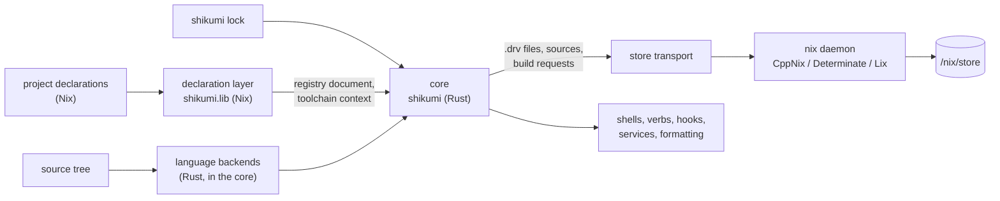
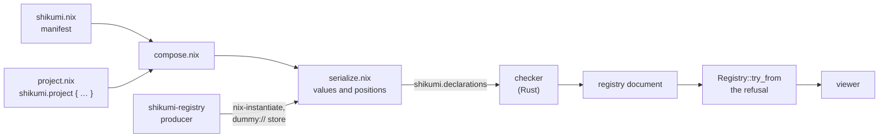

# Shikumi architecture

This page says how Shikumi is put together: who owns what, how a build and a shell entry flow, and
which invariants hold. [The capability page](../reference/capabilities.md) says what Shikumi provides.

Everything here is an accepted target unless it says it's current, and the sections marked **open**
are mechanisms still being chosen, each with what decides it. Three parts are current: the
repository's foundation (the gate, its checks in `tools/repo-check/`, and
[the benchmark harness](#the-benchmark-harness)); the base the core builds on (the path computation
of [derivation synthesis](#derivation-synthesis), both implementations of
[the store transport](#store-transport), and the re-addressing and rooting that
[early cutoff](#early-cutoff) and [roots](#caches-and-roots) rest on); and
[the declaration layer](#the-declaration-layer)'s composition, checker and registry document.

## Shape

Target structure:

There are two halves. The **declaration layer** is Nix and is small: it turns project declarations
into the registry document and a toolchain context. The **core** is one Rust binary, `shikumi`, and
does everything that scales with the size of the repository: unit discovery, `.drv` synthesis,
scheduling, early cutoff, caching, and the environment features.

Shikumi doesn't own the Nix daemon, the store, the evaluator or the compilers. It talks to the
daemon, runs the host's evaluator, and drives unmodified compilers.

## The declaration layer

The declaration layer turns a repository's project declarations into the registry document, which
the core reads, and into the toolchain context and shell environments. Its Nix half, `shikumi.lib` in
`nix/declarations/`, reads and serializes; its Rust half, the checker in `crates/registry/`, judges.
Composition, serialization, the checker, the module adapter and the registry document are current.
The toolchain context and shell environments are targets.

- **Owners.** `factory.nix` owns `shikumi.project`, which marks a plain record as a declaration and
  changes nothing else. `vocabulary.nix` owns `shikumi.lib.types`, whose constructors only build
  data. `serialize.nix` owns turning any value into a tagged tree with source positions.
  `compose.nix` owns the manifest and which declaration files a composition reads. `modules.nix` owns
  the module adapter. In the `shikumi-registry` crate, `check.rs` owns every judgement about a
  declaration, `vocabulary.rs` owns what each type accepts and the declaration record itself,
  `document.rs` owns the document's types, schema and the refusal, `render.rs` owns the text form of
  findings, and `produce.rs` and `view.rs` own the producer and the viewer. The `shikumi` crate in
  `crates/cli/` only parses arguments and lists subcommands.
- **Entry point.** `shikumi.lib.compose { root; manifest; focus; }` is pure: it reads the manifest,
  imports each composed project's declaration, and returns the serialized declarations. nix-unit
  tests call it directly, with no CLI.
- **Plain records, no module system.** `shikumi.project` takes a plain attribute set, a flat set of
  small records, and returns it marked as a declaration and otherwise unchanged, so the source
  position of every attribute survives to serialization. There's no fixpoint, no merge order and no
  priority: what a user writes is what Shikumi reads.
  Splitting a declaration is plain `import` and `//`. Composition across projects is the manifest,
  so Shikumi needs no aspects system of its own. This follows
  [the Nix style guide](../reference/nix-style.md#the-module-system): a library's own settings are
  plain schemas, and a module system reaches them through a thin adapter at the edge.
- **Checking happens in Rust.** The Nix side serializes and never decides: every value goes to the
  checker as written, tagged with what kind of value it was and with the position of every
  attribute, so a mistake Nix can still represent becomes a finding rather than an evaluation error
  that would hide the others. Only what Nix can't get past, such as a syntax error or a `throw`,
  stops evaluation. The checker checks each declaration against the declaration record and the
  repository's extension schemas, then applies the rules across projects, and collects every
  finding with a stable code, the field's path and its location.
- **The vocabulary is data.** `shikumi.lib.types` builds tagged attribute sets that serialize like
  any value, so a repository's extension schema reaches the checker the same way its declarations
  do. The checker reads it into the same type model its own declaration record is written in, and
  accepts only the public kinds, so a repository can't name the type for a command line, which skips
  the checks that keep a string out of the document. The reference page is generated from that
  model. The trade-off is that no option types are declared to a module system, so an editor can't
  complete a declaration from them; emitting an editor schema from the vocabulary is a target.
- **Positions.** `builtins.unsafeGetAttrPos` gives the start of the attribute path that defined each
  attribute, the same on CppNix, Determinate Nix and Lix, and serialization makes its file relative
  to the repository root, so the document stays identical across worktrees. Where the evaluator has
  no position inside the repository, as for list elements, attributes `builtins.mapAttrs` built and
  attributes nixpkgs' `genAttrs` built, a finding is located at the nearest enclosing field.
- **The diagnostic model.** A finding has a stable code, a structured path, a location the checker
  supplies, an optional fix, and related locations, such as the first declaration of a duplicated
  name. Findings are collected, never thrown, carried in the document as JSON and rendered as text
  the way rustc renders errors: the code and the sentence, the file, line and column, the user's line
  with the field underlined, and the fix.
- **The module adapter.** For a consumer that is a module system, NixOS, Home Manager or
  flake-parts, `shikumi.lib.modules` declares `shikumi.projects` with an option type that takes one
  `shikumi.project` result per name and hands back the same value. It has no merging and no schema;
  a second definition is the module system's error, not a merge.
- **One refusal.** The checker decides what's wrong; the document carries it.
  `Registry::try_from` is the only way the Rust side gets a registry, and it refuses a document with
  a diagnostic, an unknown field or another version. Every Rust entry point goes through it, so each
  refuses the same declarations.
- **Producing.** The producer runs the host's `nix-instantiate` on `produce.nix` against the
  `dummy://` store, which holds nothing and accepts nothing, reads the serialized declarations
  through their schema, and runs the checker. Import-from-derivation, `builtins.exec`, plugins and
  experimental features are off on the command line, `nix-path` is empty, and the child gets no
  environment at all. Every read of a build output through the evaluator fails there, whatever the
  host's store holds, and nothing in the caller's environment, such as `PWD`, reaches a declaration.
  It needs no daemon and no experimental feature on any implementation.
- **Toolchain context.** The store paths and settings a backend needs to write `.drv` files: compiler,
  linker and builder paths, base environment, system and flags. It's small and changes only when the
  lock or a declaration changes. Accepted target.
- **No builds during evaluation.** Nothing in the layer forces a derivation output, and a declaration
  that reads one through the evaluator is refused. A read by a plain path with no store context isn't
  refused; that's the known gap under [Invariants](#invariants).
- **Cost.** Composition and checking are linear in the size of the declarations. Global composition
  imports and serializes each declaration once, one visit per value and one position lookup per
  attribute, after counting each top-level field up to a budget of 100000 values and 32 levels, so a
  value that refers to itself or shares one value many times becomes a finding at that field rather
  than an endless walk. The checker visits each serialized value once. Across projects it sorts the
  manifest's directories once for overlaps, walks the dependency graph and each project's step graph
  once for loops, and keeps one map per name space for duplicates. A
  focused composition reads only its project's dependency closure. Nothing per compile unit goes
  through Nix.
- **Failure.** A finding is data, and the producer exits with every finding. An evaluation error, such
  as a declaration that doesn't parse or one that reads a build output, stops the producer with the
  evaluator's message.

## The core

One process per command. One Tokio runtime per process. CPU work such as hashing and scanning runs on
a bounded blocking pool and never on the runtime's workers. Every task belongs to the command that
started it and is cancelled with it; Ctrl-C stops outstanding builds through the transport before the
process exits.

### Context cache

The core evaluates the toolchain context through the host's Nix CLI and caches the result.

- **The evaluation can read only what the key hashed.** The keyed file set is the lock, Shikumi's own
  Nix sources, and every tracked `.nix` file inside the manifest's project directories and the
  catalog. The core copies exactly that set into the store with a filtered `builtins.path` and
  evaluates from the copy. An import from outside the set, or of an untracked file, fails loudly and
  names the file. So the key is exact by construction, and the set is also the declared list of what
  declarations may import. Evaluating from a store copy also keeps the evaluator away from sockets and
  FIFOs in the checkout.
- **The key also covers the evaluator:** its implementation and version, the system, `NIX_PATH`, and
  the experimental features and settings that change evaluation.
- **No flake entry.** Evaluating a flake copies the whole source tree into the store on CppNix and
  Lix, which costs seconds per miss on a large repository. The layer has a plain entry point instead,
  and the lock's toolchain pins are fetched as fixed-output sources by hash.
- **Cheap hits.** A stat cache (size, mtime, ctime, inode) per keyed file means a hit rehashes only
  files whose stat changed, the way Git keeps this cheap. A hit then costs one
  `git ls-files` plus a stat per keyed file, which is what the 0.2 s shell-entry target rests on. The
  target is measured on a large generated repository, not only on the fixtures.

### Language backends

A backend is a Rust component compiled into the core. There's no dynamic plugin ABI in the first
version. Each backend owns:

- **Discovery.** Finding units and their inputs. For C that's `clang-scan-deps` on the host with a
  two-level cache: explicit inputs, then the recorded discovered inputs, re-checked by content, the
  scheme ccache, Zig and Buck2 use. For Rust it's `cargo metadata` for crates, the resolved features
  and the lock, never `cargo build`. The sandboxed build checks the discovered inputs, so a stale cache
  entry fails loudly.
- **Actions.** For each stage, a unit's command, its declared inputs as content-addressed store paths,
  its toolchain context and its reproducibility flags (`-ffile-prefix-map`, `--remap-path-prefix`,
  `--remap-path-scope=all`, stable `-C metadata`, deterministic jar ordering).
- **IDE metadata.** `compile_commands.json`, `rust-project.json` or the JVM project model.

The cut points each backend uses are on [the capability page](../reference/capabilities.md#languages).

### Rust below the crate: open

Two candidates both work on an unmodified toolchain: store-seeded incremental state, and a codegen
driver that caches each codegen unit's object by its bitcode hash. Whichever wins, they introduce
concepts the core owns regardless.

- **Warm state.** A store-seeded incremental snapshot is an input that may change how fast a unit
  builds but never what it produces. It isn't part of the unit's cache key. Before it's used, fixtures
  have to show that output with and without it is byte-identical after normalization. That proves the
  mechanism, not each build, so warm-built outputs are asserted under [the provenance rule](#provenance).
  Warm state never crosses into a unit's declared inputs.
- **Cutoff by fingerprint.** Byte-identical outputs aren't the only cutoff signal. The codegen driver
  keys a codegen unit's object on a hash of its unoptimized bitcode, the JVM backend can key
  downstream compiles on an ABI jar's hash, and upstream rustc's planned public-API hash keys
  dependents on the interface. The core keeps one memo table for these. Its entries are owned by the
  backend that defines the fingerprint, and each carries the backend's **load-compatibility
  condition**: when a reused output is still accepted by whatever consumes it. Reused outputs are
  asserted under the provenance rule.
  - Within a crate, codegen unit objects keyed by bitcode hash are joined by the linker, not loaded by
    rustc, so reuse is sound.
  - Across crates, Rust reuse is off. rustc records each dependency's crate hash (SVH) in a
    dependent's metadata and refuses a dependent built against a different one. Reuse turns on only
    once rustc records the public-API hash there instead, and the upstream plan says whether it will.
    The failing case is run to confirm the check before anything relies on it.
  - [Early cutoff](#early-cutoff)'s re-addressing is the case where the fingerprint is the output's
    own bytes.

### Derivation synthesis

The core writes ATerm `.drv` files itself and computes their paths. It never asks the evaluator to
generate per-unit derivations. A one-file edit writes O(affected units) `.drv` files.

- Unit derivations are input-addressed. Their `inputSrcs` are content-addressed store paths only:
  sources, and the re-addressed outputs of upstream units. Their `inputDrvs` are the toolchain context
  derivations, which rarely change.
- Unit builders aren't stdenv. stdenv derives `-frandom-seed` from `$out`, so it changes on every
  edit, and its setup cost adds to the overhead of every derivation. Shikumi ships minimal builders of
  its own.
- **Invariant:** the computed `.drv` path matches what each implementation computes, bit for bit. A
  conformance test against CppNix, Determinate Nix and Lix guards it.

**Current:** the `shikumi-derivation` crate, in `crates/derivation/`, is the one place Shikumi
computes a store path. It models input-addressed and fixed-output derivations, writes their ATerm,
and computes the hash modulo, the output paths, fixed-output paths (flat and recursive sha256) and the
`.drv` file's text-addressed path. It also serializes NARs and computes the content-addressed path of
a source from its NAR hash, name and references, refusing a self-reference. The store transport and
the conformance harness take paths from it and never derive one. The `conformance-*` gate checks
compare it with CppNix 2.35.3, Determinate Nix 3.24.2 and Lix 2.95.4 and 2.96.0, each in a NixOS VM,
as [the capability page](../reference/capabilities.md#store-conformance) lists.

It refuses what not every implementation handles the same way: environment variable `__json`, which
CppNix reserves for structured attributes; a system string holding a quote or a backslash, which
every implementation writes into the `.drv` unescaped; and a NUL byte anywhere a builder would see
it, which Lix refuses to build and CppNix cuts short.

### Early cutoff

Lix removed content-addressed derivations, and CppNix and Determinate Nix still mark them
experimental, so Shikumi does early cutoff itself.

1. A unit builds.
2. The core reads its NAR hash and references from the daemon and computes the content-addressed path
   for those bytes locally, with the same conformance-tested path code. If that path is already
   valid, nothing is transferred. Only new bytes are copied in, which is exactly when the downstream
   rebuild costs more anyway.
3. Downstream units name that path. Identical bytes give an identical downstream `.drv`, whose output
   is already valid, so nothing rebuilds.

Cutoff is only as good as the backends' reproducibility, so every backend has a determinism check
that builds a unit twice in separate sandboxes and compares the bytes.

**Current:** step 2 is `readdress` in the `shikumi-outputs` crate, in `crates/outputs/`, the one owner
of re-addressing. It works over either transport: one path-info query and one validity query for a
whole batch, then one add carrying only the NARs whose address isn't valid, each streamed from the
daemon back into it. It reports the NAR bytes it sent per output, so a cutoff is measured rather than
assumed. The conformance checks build a unit, re-address it, rebuild it with a changed derivation and
the same bytes, and check that the second re-add sent nothing and the dependent's `.drv` and output
were already there; a changed output has to give a new dependent. The scheduler that calls it isn't
built.

**No self-references.** A content-addressed source path can't reference itself, so a re-addressed
unit output must contain no reference to its own store path. `readdress` refuses such an output
before adding anything, naming it. Each backend's determinism check also
scans the output for its own path. Units whose output has to reference itself, such as a shared
library with a RUNPATH to itself or a wrapper script, are leaves that aren't re-addressed. They need
no cutoff, because nothing in the graph depends on their bytes.

**Dataflow, not barriers.** A downstream `.drv` can only be written once its inputs are re-addressed,
so the scheduler starts each unit as soon as its own inputs are ready, never waiting for a level of
the graph. The latency floor of an edit is then the depth of the edited path times one step's
overhead: the derivation's fixed cost, the re-add, and a validity query. That floor is measured as a
curve over depth.

### Provenance

Some mechanisms put an output in front of a consumer without a Nix sandbox having produced it from the
unit's declared inputs: warm state, reuse through the fingerprint memo, and Shikumi running the
compiler itself. Nix can't tell such an output from a real one, because an input-addressed path is
accepted from whoever registers it first, and a binary cache then hands it to everyone.

So every output carries a provenance, owned by the core:

- **Built:** a sandboxed derivation produced it from its declared inputs.
- **Asserted:** Shikumi produced or reused it some other way.

An asserted output is local only. It's never pushed to a shared cache, and never re-addressed into a
downstream input that gets pushed, until a sandboxed build confirms its bytes. The push path enforces
that. CI and the push path build cold under the sandbox, so shared caches hold only built outputs. On
a developer machine, asserted outputs are bounded by a periodic cold rebuild of the units they cover.

### Execution: open

The candidates are measured on the same fixture, and the numbers decide:

| Candidate | Sandbox per unit | Strength | Cost |
| --- | --- | --- | --- |
| One derivation per unit | Yes | Simplest, hermetic, remote builders work unchanged | A fixed overhead per unit, which the overhead fixture measures |
| Batched derivations with per-unit outputs | One per batch | Fewer sandbox setups, still cached per unit | Batch boundaries decide what rebuilds |
| Shikumi runs the compiler and adds outputs by content | Shikumi's own | Fastest edit loop, allows warm compiler processes | Shikumi guarantees hermeticity, and remote builds need their own path |
| A mix per stage | Varies | Each stage gets the cheapest fitting mechanism | More than one execution path to keep correct |

Whichever wins, the action, its inputs and its output path are the same records, so the choice is
internal to the execution component and changing it later doesn't touch backends.

The third candidate is admissible only with a sandbox Shikumi owns that enforces "only declared inputs
visible", and its outputs are asserted until a derivation build confirms them. There's no namespace
sandbox on macOS, so its cost is measured per platform, not on Linux alone.

### Store transport

All daemon access goes through one trait, `StoreTransport` in `crates/transport/`, with two
implementations; the trait and both are current. Every operation takes a batch and is async, so one
runtime can drive builds, queries and adds side by side: adding `.drv` files, adding
content-addressed sources, building outputs, querying validity and path info, and registering roots.
Reading a valid path's NAR is the one per-path operation, because both the CLI and the protocol
stream one NAR at a time. A NAR is streamed both ways, so memory holds what's in flight rather than
the batch, and a NAR reader opens nothing until it's read, so a batch of them holds one connection at
a time.

- **Worker protocol.** `WorkerStore`, over the local daemon's unix socket or `ssh-ng`, which runs
  `nix-daemon --stdio` on the far side as Nix's own client does. It offers protocol 1.37 and speaks
  what the daemon answers: 1.37 with CppNix and Determinate Nix, and 1.35 with Lix, which froze the
  protocol at the Nix 2.18 level. It's how the core talks to the daemon.
  - `.drv` files and sources go in one `AddMultipleToStore` stream per batch, references first, each
    with its content address, so the daemon re-derives every path it's sent. While one source's NAR
    streams, the next ones are opened, so a batch of small re-added outputs doesn't pay a round trip
    each in series. Validity and builds
    are one request per batch. Path info has no batched request, so a batch's requests are written
    back to back while the replies are read, split across connections when it's large. Each cost
    grows linearly with its batch.
  - It owns its connections: two bounded pools of long-lived ones, one for operations and one for
    NAR reads, so an add whose sources are NARs read from the same store can't wait on itself. A
    connection is reused only after an operation finished cleanly. An error, or a dropped future,
    closes it, and the daemon interrupts whatever it was doing for that connection, a running build
    included. A daemon error comes back in the daemon's words with its last log lines.
- **CLI.** `CliStore` always works and serves as the conformance oracle. `.drv` files go through
  `nix derivation add` in the JSON dialect of the implementation on the PATH, each starting as soon as
  its own inputs are added, and each implementation checks the output paths it's given against its
  own. Sources go through a throwaway local binary cache whose `.narinfo` carries the references and
  the content address, and `nix copy --from`; no other CLI command adds a path with references.
  Builds, validity and path info use `nix-store` with many paths per invocation, NARs come from
  `nix-store --dump`, and roots from `nix-store --realise --add-root`.

Lix plans to replace the legacy protocol with Cap'n Proto RPC once that's stable. When it does, that
becomes a third implementation of the same trait. The core owns global concurrency: a pool of
long-lived connections and one build-slot semaphore. It doesn't rely on the daemon's `max-jobs`, which
is counted per connection.

**Trust.** Shikumi works as an untrusted daemon user. Adding `.drv` files, building them, adding
content-addressed paths with references, reading NARs, registering indirect roots and collecting
garbage all work untrusted, and the conformance checks prove each with an untrusted test user on every
implementation, through both transports and over `ssh-ng`, where the far side's user is untrusted
too. A path whose content address doesn't reproduce it is refused on every implementation: the daemon
checks it for an add through the worker protocol, and `nix copy` refuses one without references before
it reaches the daemon. Shikumi never sends a derivation whole for the daemon to build, which every
implementation refuses for an input-addressed one from an untrusted client; it adds the `.drv` and
builds that. [The capability page](../reference/capabilities.md#store-conformance) lists each
implementation's answers. Two things need the machine's admin, and the core detects and reports each
instead of failing silently:

- **Substitution** from a Shikumi cache needs the cache in `trusted-substituters` and its key in
  `trusted-public-keys`.
- **Remote builders** need input-addressed inputs that don't verify themselves (toolchain context
  outputs, Shikumi's builders, locally built tools) to be signed. Shikumi signs them with a key the
  remote's admin adds to `trusted-public-keys`. Content-addressed and fixed-output paths need no
  signature.

### Caches and roots

- **Action index.** A Shikumi-level index of which unit outputs are known to exist locally and in each
  binary cache, so the core asks a cache only for paths it expects to find. A cache can publish one
  manifest per commit, so a fresh worktree fetches one manifest and then targeted NARs.
- **GC roots.** Each build writes one manifest store path whose references are every live unit output
  and `.drv`. The worktree roots that manifest at `.shikumi/roots/`, plus a bounded number of previous
  generations. A deleted worktree leaves a dangling root, which the next GC collects. **Current:** one
  manifest and its root, `root_manifest` in `shikumi-outputs`: a content-addressed path listing the
  live paths and referring to them, made a link and registered as an indirect root through the
  transport. The link is on the daemon's machine, so the root goes through the local daemon only, and
  the `ssh-ng` transport refuses it. Generations and the `.shikumi/roots/` layout are targets.
- **Eviction.** Nix GC has no notion of least recently used, so Shikumi keeps a shared warm manifest of
  recently hit units with its own last-used times, and leaves the rest to the daemon's GC.
- **Non-redistributable marks** travel with an output, and the push path refuses to upload a marked
  path to a public cache.
- **One owner for shared state.** Commands run concurrently: two builds in two worktrees, or a build
  beside a format. The action index, provenance records, the warm manifest with its last-used times,
  the memo table and the format cache live in one per-user state database that every command writes
  through transactions, so the database is their single owner. Each worktree's root generations are
  written by atomic rename under a per-worktree lock. The database's schema is versioned, with
  migrations, as [Contracts](#contracts) explains.

### Environment features

Each has one owner in the core, and each reads the registry document rather than its own copy:

- **Task engine.** Verbs, steps, `after` and `afterVerbs`, resource classes, checkout locks,
  requirement tags, the lease hook, soft edges for advisory pre-run services, and cached steps as
  derivations. Ordering and selection are different relations in its graph.
- **Service manager.** Per worktree, independent of the shell. See [the next section](#service-supervisor).
- **Hook installer.** Writes, retires and reports its own shims under the worktree's hooks path, and
  dispatches staged files to exactly one format and one lint scope each.
- **Format multiplexer.** One formatter per file, scoped per project, with a content-keyed cache shared
  across worktrees. Whether it wraps treefmt or is Shikumi's own is **open**.
- **Shell activation.** Builds the environment from the cached context, replaces PATH, and emits the
  activation for bash, zsh or fish.
- **Query and trace.** The affected query, dependencies, reverse dependencies and "why did this
  rebuild", plus build traces with time by phase.

### Service supervisor

A background service runs under a per-worktree Shikumi supervisor process, which owns every service's
process group, readiness, logs, restart policy and shutdown. The supervisor lives exactly as long as
at least one service in its worktree does, and exits when the last stops. Shikumi uses its own
supervisor rather than systemd `--user` or launchd, because not every Linux runs systemd and one
implementation behaves the same on every platform.

Its lifetime rules, each with a test that drives it:

- **Supervisor death.** Per-worktree state records each service's pid, process group and start time,
  so a reused pid isn't mistaken for a live service. If the supervisor dies, the next command adopts
  or stops the orphaned services before anything starts. Test: kill -9 the supervisor, start the
  service, get exactly one instance.
- **No exit race.** One per-worktree lock decides supervisor lifetime. The supervisor exits only while
  holding it with zero services, and a client that finds no live supervisor under the lock starts one.
  Test: start and stop in a tight loop from two processes, never two supervisors and never a lost
  start.
- **Worktree removal.** A supervisor whose worktree directory is gone stops its services and exits.
  Test: `git worktree remove` with a service running.
- **Version skew.** The control protocol carries a version. A CLI that finds a supervisor on another
  version either speaks that version or asks it to hand its services over to the new binary. It never
  sends a command the old one would misread. Test: a newer CLI against an older supervisor.

## Contracts

| Contract | Format | Owner | Readers |
| --- | --- | --- | --- |
| Registry document `shikumi.registry` | JSON with a schema, `registry.schema.json` version 1.0 | `shikumi-registry`'s checker produces it from the serialized declarations | every step and service, repository tools, the viewer |
| Serialized declarations `shikumi.declarations` | JSON with a schema, `declarations.schema.json` version 1.0 | declaration layer | the checker |
| Lock | JSON lines with a schema, one artifact per line, sorted and sharded | core | core, reviewers, grep |
| Build trace | JSON lines with a schema | core | benchmarks, profiling tools |
| Cache manifest | JSON with a schema | core | core on other machines |
| Benchmark record | JSON lines with a schema, `record.schema.json` version 2 | benchmark harness | benchmark comparisons, the execution measurement, every backend's speed claims |
| Overhead fixture graph | JSON with a schema, `overhead-units.schema.json` version 1 | benchmark harness | the execution measurement |

A contract changes only through a reviewed design change, by a version bump its schema records. Four
contracts are current: the two benchmark contracts, with their schemas in `bench/schema/`, and the
registry document and the serialized declarations, with their schemas in `crates/registry/schema/`.

The state database isn't a contract: no other program reads it. It's the core's internal state, with
a versioned schema and migrations so a newer Shikumi opens an older database.

### The benchmark harness

The benchmark harness is a maintained component, the `shikumi-bench` crate in `bench/`, and it's
current. It owns the fixture generators, the native-tool baselines and the two benchmark contracts
above. Every speed claim in Shikumi is measured through it. [The capability page](../reference/capabilities.md#benchmark-fixtures)
says what it provides today.

## Scale

Shikumi is designed for repositories of 100k source files, a few thousand crates and many teams.

- **Edit loop:** O(affected units) `.drv` writes and builds, plus one batched validity query. The
  evaluator isn't in it.
- **No-op build:** one batched validity query against the action index. Target 300 ms or less.
- **Shell entry on a cache hit:** a stat per keyed Nix file, rehashing only changed ones. Target 0.2 s
  or less.
- **Store:** one path per unit stage, so millions of small paths over time. GC and SQLite
  registration at that scale are measured before anything depends on them.
- **Lock:** linear in the number of artifacts, sharded so concurrent changes rarely conflict.

## Invariants

[The philosophy](../philosophy.md) holds the laws every part keeps, such as using only what all three
Nix implementations share and having one owner per concern. These are the invariants this design's
own mechanisms hold, with the part that holds each and the check that proves it. The checks are
accepted targets like the rest of the page, except those marked current.

| Invariant | Held by | Checked by |
| --- | --- | --- |
| A computed `.drv` path matches each implementation's, bit for bit | [derivation synthesis](#derivation-synthesis) | the `conformance-*` gate checks against CppNix, Determinate Nix and Lix; current |
| Cached outputs are reproducible | [each backend](#early-cutoff) | its determinism check: two sandboxed builds, compared |
| A re-addressed output has no reference to its own store path | [early cutoff](#early-cutoff) | `readdress` refusing it, checked on every implementation; current. Before that, the determinism check's scan for the output's own path |
| A cached output was produced with only its declared inputs visible | the Nix sandbox, or [Shikumi's own](#execution-open) | the sandboxed build re-checking [discovered inputs](#language-backends) |
| An asserted output is never shared until a sandboxed build confirms it | [provenance](#provenance) | the push path's refusal |
| Daemon operations work as an untrusted user | [store transport](#store-transport) | a run as an untrusted test user on every implementation, through each transport; current for adding `.drv` files and sources, building, reading NARs, indirect roots and collecting garbage |
| A worktree never has two supervisors or a lost service | [service supervisor](#service-supervisor) | the four lifetime tests |
| Every Nix implementation serializes the same declarations and yields the same findings, for declarations that don't inspect the evaluator | [declaration layer](#the-declaration-layer) | the `registry-no-builds-*` gate checks, which hold each implementation's serialized declarations for every fixture to one tracked reference, and the registry crate's tests, which hold the document and the rendered findings those declarations give; current |
| No builds during evaluation, no import-from-derivation | [declaration layer](#the-declaration-layer) | the `registry-no-builds-*` gate checks, one per implementation, which plant output reads and a `builtins.exec` the producer has to refuse on every implementation; current, with the known gap below |
| The registry document holds no store paths and is identical across worktrees of one commit | [declaration layer](#the-declaration-layer) | the checker refusing a store reference or the repository's location, and the `registry-worktrees` gate check, which compares two worktrees and plants a leak it has to catch; current, with the known gap below |

**Known gap in the last two rows.** A declaration can read a file by a plain path that carries no
store context: a store path whose context it stripped, an untracked file or one outside the
repository, `.git`, a directory listing of the checkout, a directory reached through a symlink, or
the clock, or the host's system through `builtins.currentSystem`. It can also carry a value derived
from the repository's location, such as its parent directory. Its document can then depend on the
host or the worktree, and no check plants such a read beyond the worktree's name. The gap is owned
by [the context cache](#context-cache), whose evaluation from a store copy of exactly the keyed files
makes pure evaluation possible.
