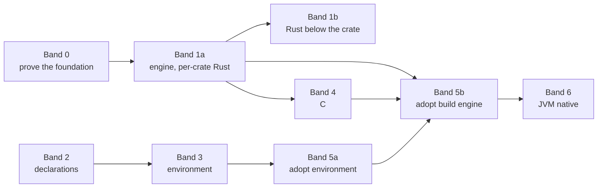

# Shikumi roadmap

Status: **approved 2026-11-07.** Band 0 is next; nothing is in execution yet.

## Goal

Build Shikumi, a generic build system and project registry with the Nix store as its cache, granular
below each compiler's coarsest unit, and adopt it in a first consumer in place of that repository's
devenv-based registry. The original request: cut each language's pipeline at the stages where an output
can be cached on its own, let the Nix store cache those units, finish the rest ourselves, and make sure
it's never slower than plain compiling.

**In scope:** everything in [the spec](spec.md). **Out of scope:** its non-goals, and repository-specific
tools, which stay the consuming repository's declarations.

## Basis

- Shikumi repository: no commits yet. These documents are its first.
- Research: [the reports](README.md#research), each tagging its claims verified, inferred or unverified.
  Research into the first consumer's own build is kept privately.
- Host: Linux, with Lix as the system Nix.

## Bands

| Band | Goal | Design openness | Execution |
| --- | --- | --- | --- |
| 0 | Measure the execution candidates and settle the Rust strategy before anything rests on them | Open: execution mechanism, Rust below the crate | Not started. [Effort page](efforts/foundation/README.md) |
| 1a | The build engine end to end, proven on per-crate Rust | Waits on Band 0's execution ruling | Not started |
| 1b | Rust below the crate | Waits on phase 0.4 | Not started |
| 2 | Declaration layer, registry document, catalog, toolchains, lock. Independent of Band 0, so it can start beside it | Settled | Not started |
| 3 | Shells, tasks, services, hooks, formatting | Settled apart from the format multiplexer's mechanism | Not started |
| 4 | C backend | Settled: cut points in the spec | Not started |
| 5a | The first consumer adopts declarations, shells, tasks, services and hooks, and drops devenv | Planned jointly with the consumer's architect | Not started |
| 5b | The first consumer adopts the build engine for Rust and C. Gradle runs as an opaque step | Planned jointly with the consumer's architect | Not started |
| 6 | Native Kotlin and Java | Staged path below | Not started |

Phases for Band 0 are written in full on its effort page. Bands 1 to 6 are outlined below and get full
phase pages at Band 0's closure, once the execution mechanism is known, because their acceptance depends
on it.

### Band 1: build engine and Rust

Rust goes first because it's the novel part: nobody, Bazel and Buck2 included, does cached Rust builds
below the crate.

Band 1 has two halves. Adoption depends only on the first.

- **1a, per-crate.**
  1. **Engine.** Dataflow scheduler, action records, the chosen executor, early cutoff by re-addressing,
     provenance, the state database, action index, GC manifest roots, eviction, build traces.
  2. **Rust per-crate baseline.** The crate graph from `cargo metadata`, metadata and codegen as separate
     stages, build scripts and proc macros as declared steps, crates fetched from the lock,
     `rust-project.json`.
  3. **Queries and tests.** Affected query, dependencies, reverse dependencies, "why did this rebuild",
     and cached tests on nextest's model.
- **1b, below the crate.** The mechanism phase 0.4 proves: store-seeded incremental, the codegen driver,
  or both, with warm state, the fingerprint memo and their outputs asserted under the provenance rule.
  Per-crate alone isn't an accepted end state for Band 1, so the band doesn't close without 1b. 1b may
  run after the first adoption.

Acceptance runs on the benchmark fixtures and on a private real-world Rust workspace, out of tree at a
recorded commit. No private code is vendored.

Alongside it, Shikumi's contributions upstream: the `-Zls=public_hash` printer and the split PRs of
rust#158844, so cross-crate cutoff by public API reaches unmodified nightly.

### Band 2: declarations

1. **Compose, schema, validation, registry document and viewer.** nix-unit tests through
   `shikumi.lib.compose`.
2. **Catalog, conflicts, overrides, toolchains, context cache and lock.** Includes the fixed-output
   fetchers for crates and the lock format.

### Band 3: environment

1. **Shell activation, task engine and commands.** The 0.2 s cached-entry target is its acceptance.
2. **Services and hooks.**
3. **Format multiplexer.** The phase opens by settling whether to wrap treefmt or build our own. treefmt
   v2's limits for this use: one config per tree root, it refuses to start if any formatter is missing,
   and its cache is per checkout.

### Band 4: C

Discovery with `clang-scan-deps` and the two-level cache, actions with reproducibility flags, the
determinism check, `compile_commands.json`, and clang and gcc as separate toolchain identities. Acceptance
runs on a generated C fixture and on a private real-world C build, out of tree at a recorded commit.

### Band 5: first adoption

Runs in the consuming repository under its own orchestrator, with this roadmap's architect and that
repository's architect settling the combined design first. Its detailed plan is private to the consumer.

- **5a, after Band 3:** migrating the consumer's project declarations, a version path from its registry
  document to `shikumi.registry` for every tool that reads it, and removing devenv and its per-directory
  locks. This is the first point the consumer uses Shikumi day to day.
- **5b, after Bands 1a, 4 and 5a:** building the consumer's Rust and C through the engine, and wrapping
  Gradle as one opaque offline derivation with its Maven artifacts in Shikumi's lock.

Most of the consumer's code is Kotlin, which stays an opaque Gradle step until Band 6. So the granular
payoff at 5b covers its Rust and C, the smaller part of its code. Gradle keeps its own incremental
compile meanwhile.

### Band 6: JVM native

1. Lock every Maven artifact with URL and sha256, one fixed-output derivation each.
2. Move pinned downloads and binary patches that Gradle runs today into derivations.
3. Compile Kotlin and Java per source set, with ABI-jar cutoff through `jvm-abi-gen`. Splitting finer than
   a source set is risky in Kotlin: same-package references need no import, `internal` names are mangled
   per module, and sealed hierarchies must compile together.
4. Jars, checks and tests.

JVM startup cost per derivation is the main risk. Nix can't keep a compiler daemon alive across
derivations, so the candidates are a JDK AOT cache built as its own derivation, batching, or a warm
worker under Shikumi's own sandbox. The Band 0 harness measures them when this band opens.

## Splits and joins

- **At approval,** Band 0 opens. Band 2 doesn't depend on the execution mechanism, so the orchestrator
  may open it beside Band 0 when there's capacity. The roadmap carries no schedule.
- **Band 0's closure** owes the opener for Band 1a.
- **Band 1a's closure** owes openers for Band 1b and Band 4.
- **Band 2's closure** owes the opener for Band 3.
- **Band 3's closure** owes the openers for 5a, on Shikumi's side and for the consumer's architect.
- **Band 5b** is a join on 1a, 4 and 5a. The last of them to close owes its openers.

## Decisions waiting on the user

1. **The speed bar.** The goal says "never slower than plain compiling", while phase 0.3 proposes a cold
   build within 15% of Cargo. Either the bar is "never slower", or 15% on a cold build is a tolerance the
   user accepts. The edit loop is where Shikumi has to win either way.

## Rulings

Settled; don't relitigate without contradicting evidence. The full list is in
[the spec's decisions](spec.md#decisions). Rulings made during execution are added here.

- **Provenance** (design review): outputs no sandbox produced are asserted, local only, until a
  sandboxed build confirms them. It's the single soundness rule for warm state, fingerprint reuse and
  Shikumi-run compiles.
- **Rust cross-crate memo reuse is off** until rustc records the public-API hash, not the SVH, in a
  dependent's metadata.

## Standing environment

- Linux workstations. The host's system Nix is Lix, and it isn't changed.
- CppNix and Determinate are exercised in NixOS VM tests or separate stores, never by changing the host.
- No macOS machine. macOS stays a supported target with unverified status until a machine or CI runner
  exists.
- Long runs, gates and the measurement matrix go through the maintainer's run queue, alone on a quiet
  machine when they measure.
- Phase worktrees live outside the checkout, in the maintainer's worktree container. Evidence goes under
  `.runtime/<effort>/<phase>/` in the main checkout. The orchestrator owns cleanup.

## Findings and risks

| # | Finding | Where it bites | Handling |
| --- | --- | --- | --- |
| 1 | Lix intends to drop the legacy worker protocol once its Cap'n Proto RPC is stable | Store transport | One transport trait with a CLI fallback, and a CI matrix over all three implementations |
| 2 | Per-derivation overhead is 8 to 15 ms on Linux. Fixed latency dominates small edits (Shinobi: 15.0 s against ninja's 9.8 s on about 100 units) | Edit loop | Band 0 measures the candidates against Cargo and a 1 s edit-loop bar |
| 3 | rustc's crate hash covers every body and span, so `.rmeta` cutoff isn't real today. Nobody, Bazel and Buck2 included, does cached Rust builds below the crate | Rust granularity | Phase 0.4 proves store-seeded incremental and the codegen driver. Upstream's public-API hash is expected on nightly around 2027 |
| 4 | Millions of tiny store paths stress GC and SQLite | Store scale | Band 0 measures GC at scale |
| 5 | Real-world C builds often aren't reproducible (absolute paths in debug info, no prefix maps) | Early cutoff for C | The C backend sets prefix maps; the determinism check enforces them |
| 6 | No macOS numbers anywhere | macOS support | Unverified status until a machine exists |
| 7 | nixpkgs carries only stable rustc, and the codegen driver needs the `rustc-dev` component | Rust backend, Nix dependency rule | Shikumi fetches the official components as fixed-output derivations itself rather than adding rust-overlay or fenix |
| 8 | The codegen driver uses rustc's internal APIs, which change every release | Rust backend upkeep | Phase 0.4 measures the payoff. If adopted, every toolchain bump needs a port and a re-run of the CGU-hash checks |
| 9 | rustc checks dependency crate hashes when it loads a crate, so reusing an output built against an older `.rmeta` is refused | Cutoff by fingerprint for Rust | Ruled: cross-crate reuse is off until rustc records the public-API hash. Phase 0.4 runs the failing case |
| 10 | Gradle's lockfiles and verification metadata carry no URLs and use sha1, so they can't produce fixed-output derivations | JVM lock | Shikumi's lock records URL and sha256 itself |

## Cold-start reading

1. [Spec](spec.md), then [architecture](architecture.md).
2. [Nix substrate](research/nix.md), sections "Early cutoff without CA derivations" and the spike.
3. [Rust below the crate](research/rust-subcrate.md).
4. The effort page of whichever band is running.
